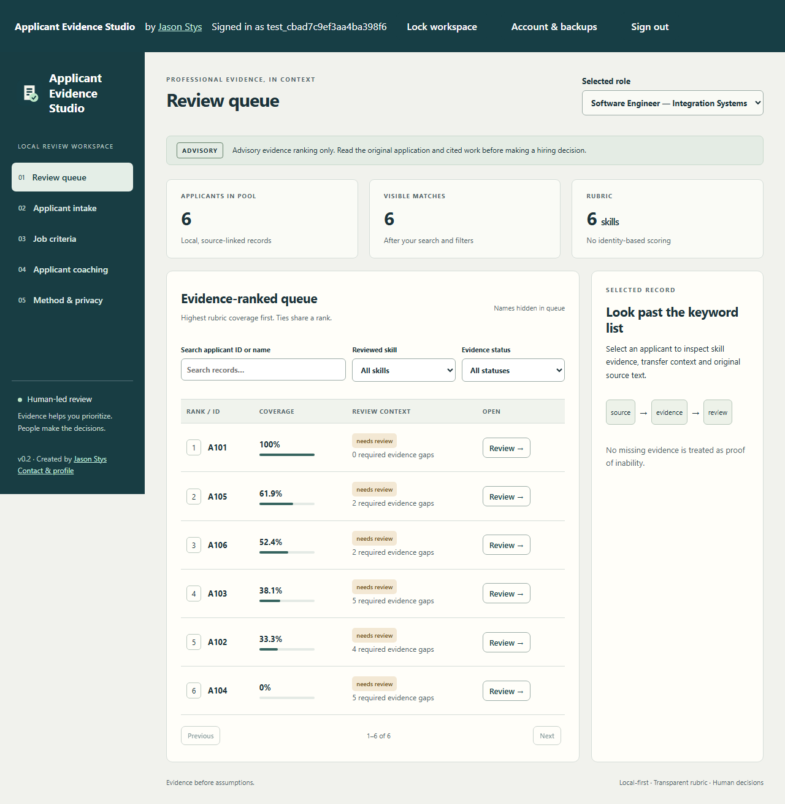

# Applicant Evidence Studio

The **0.3.1 source update** adds a native owner window with Open workspace,
Help, Runtime notices and Quit controls, patched CPython 3.14.10, verified
embedded source/runtime resources, and exclusive profile ownership. Quit waits
for active requests to finish before closing the listener and releasing the
account-store lock. The existing account directory, account schema and encrypted
workspace format are preserved. See the [native application guide](docs/native-application.md)
and [current native validation report](docs/reports/native-application-2026-11-11.md).
Release availability is shown on the official downloads page; a passing source
build alone does not publish an application.

Published portable downloads are checked through a real extracted native
application and encrypted comparison/export journey. See the
[portable acceptance guide](docs/published-acceptance.md) and
[current validation report](docs/reports/portable-acceptance-2026-11-09.md).

[](https://github.com/JasonStys/applicant-evidence-studio/actions/workflows/validate.yml)

A private-account, source-linked applicant review and career-coaching application, created by **Jason Stys**. Reviewers can prioritize an authorized applicant pool using a transparent professional-skills rubric, inspect original evidence, and make their own decisions. Applicants can identify evidence gaps and download a factual, role-tailored resume draft.

Version **0.3.0** introduced captured two-record criterion/evidence comparison, clarification prompts and private report export; those features remain in 0.3.1. Version0.2 introduced real registration/login, encrypted private workspaces, local browser document processing, encrypted backup/restore, account recovery/deletion, help and portable desktop downloads. The host stores **ciphertext**, not readable resumes. Account aliases and operational metadata remain visible to the host. Encryption cannot protect against a malicious future host or compromised device; see [the privacy model](docs/private-accounts.md).

Use [official downloads](https://github.com/JasonStys/applicant-evidence-studio/releases) and [installation/help](docs/install.md). Contact [Jason on LinkedIn](https://www.linkedin.com/in/jason-stys-31b30b351/) or visit [his GitHub profile](https://github.com/JasonStys). Never send private documents or credentials in an issue. Public account hosting requires a separate approved HTTPS provider/domain; no public backend URL is provisioned by committing this repo.

## Private website or application

The one-file portable desktop build includes the Python service and browser UI:
verify its SHA-256, extract, then launch it. No Python/Node setup is needed by end
users. It opens your default browser and keeps a loopback-only service running.
These are **unsigned portable executables**, not signed installers/notarized apps.
Desktop OS/architecture support is identified in each release; mobile uses the
website or installed web app, not a desktop executable.

For developers after the dependency/build steps below:

```powershell
.\.venv\Scripts\python.exe -m app.cli accounts --data runtime/private --port 8054
```

Open `http://127.0.0.1:8054/`. Create an alias/login password and save the random
login recovery code. Choose a **different** long vault phrase; it stays on your
device and cannot be recovered by Jason or the server. New accounts are empty.
Create a rubric or explicitly load fictional examples via Account & backups.
Documents are parsed, reviewed and scored locally; only encrypted saves go to the
account service. Private mode makes no external AI/GitHub/LinkedIn calls. Existing
external AI adapters remain in the separate trusted developer mode below.

On supported browsers install via Install app, or iOS Share → Add to Home Screen.
Connectivity to the account service is required; the service worker deliberately
does not cache private responses. For real HTTPS hosting see [deployment contract
and operational gates](docs/hosting.md). GitHub Pages alone cannot run the backend.



**Advisory only:** scores describe reviewed evidence coverage, not a probability of job success or an automatic hire/reject decision. Read the application and cited work yourself. This portfolio prototype does not claim to be bias-free, legally compliant, or production-ready for real hiring.

## What it does

| Feature | Behavior |
| --- | --- |
| Ranked review queue | Weighted skill coverage, shared ranks for ties, search, skill/status filters and pagination. Repeated claims do not inflate scores. |
| Job configuration | Vetted professional skills, weights, target evidence strengths and required-evidence flags. Description-based suggestions are editable drafts requiring approval. |
| Consistent applicant records | Private sources, professional claims, explicit education outcomes/transfers, employment duration, review state and consent in a normalized JSON contract. |
| Resume intake | Bounded UTF-8 TXT/MD, text-based PDF and DOCX extraction. Unsupported, encrypted, scanned, damaged or ambiguous content is surfaced for review rather than guessed. |
| Professional sources | Private mode accepts applicant-provided professional exports/text. Legacy developer mode can import one explicitly authorized public GitHub README. No broad people search, login bypass or applicant-code execution. |
| Evidence quality | Reviewers check citations and choose declared, practiced, demonstrated or assessed strength. Coursework and projects can demonstrate skills without being relabeled as paid employment. |
| Applicant coaching | General/role-specific resume advice, LinkedIn presentation suggestions and practical portfolio-gap project plans. |
| Downloadable results | Escaped printable HTML resume draft, consistent applicant JSON and criterion-by-criterion advisory report with rubric fingerprint. |
| Optional AI | Legacy developer mode offers Ollama/compatible chat API citation-validated suggestions. Private accounts use deterministic local coaching and never send data to these providers. Scores remain deterministic in both modes. |
| Batched workflow | Atomic batches of up to 100 records. Private mode: up to 1,000 records within an 8 MiB workspace budget; legacy developer mode: 10,000 records. Optimistic revisions prevent stale-edit overwrites. Measurements are not production capacity claims. |

Identity, protected traits, personal biography, school prestige, photos, follower counts and free-form source text are not ranking inputs. Raw source text is preserved privately for human review; it is not automatically sent to a model. Missing evidence is **unknown**, not proof of inability.

## Legacy local developer mode

Requires Python 3.12+ and Node.js 24. No Docker or external AI service is needed for the normal workflow.

```powershell
python -m venv .venv
.\.venv\Scripts\python.exe -m pip install --no-deps -r requirements.lock
.\.venv\Scripts\python.exe -m pip install --no-build-isolation --no-deps -e .
npm ci
npm run build
.\.venv\Scripts\python.exe -m app.cli seed --data runtime/demo
.\.venv\Scripts\python.exe -m app.cli serve --data runtime/demo --port 8014
```

On Linux/macOS use `.venv/bin/python` instead. Open the session link printed by the launcher. The token is per process and stored only in the browser tab's session storage; resume data is not cached there. Do not publish that link. The service binds to **127.0.0.1 only** and accepts its configured Host/Origin.

`seed` is explicit and refuses duplicate IDs; it never silently replaces an existing database. For a clean private workspace, use a different `--data` directory, create a job in **Job criteria**, then import authorized records. The responsive UI is usable in a browser; it is not a signed native installer or a public mobile/cloud deployment.

## Typical review

For a closer review, tick **Compare ID** beside exactly two queue records, then **Capture selected evidence**. The new [criterion comparison](docs/evidence-comparison.md) uses one captured rubric and record revisions, shows strongest reviewed citations, excluded unreviewed/duplicate claims, unknown evidence and factual clarification prompts. It preserves selection order and never chooses a winner. Human observations can accompany a private JSON export; they do not change scores, records or hiring outcomes. Private accounts build this report entirely in the browser, with no plaintext request or workspace write.

1. Read the job description and approve a relevant skill rubric. Avoid unnecessary requirements and unjustified weights.
2. Import authorized resumes or a normalized JSON batch. Inspect parser warnings and original documents.
3. Add source-linked claims and explicitly check evidence quality/ownership. Proposed keyword mentions stay unreviewed and score nothing until reviewed.
4. Inspect the queue, score breakdown, required gaps, transfer chronology and uncertainty. Seek clarification or an accessible work sample where needed.
5. Read the best-fit applications yourself. Make hiring decisions outside this advisory tool.
6. Open **Applicant coaching** for practical improvements and a downloadable factual draft. Verify every fact before submitting it.

See [docs/user-guide.md](docs/user-guide.md) for a full walkthrough and [examples](examples) for fictional cases and input schemas.

## Why these languages

Python handles validated domain logic, safe document extraction, AI adapters and testing. TypeScript/React handles typed browser interaction. SQL provides transactional persistence; HTML/CSS provides portable accessible presentation. JavaScript handles compiler-AST documentation tooling. Languages are chosen for their jobs, not added as decorative demonstrations.

## Test and validate

```powershell
.\.venv\Scripts\ruff.exe check app tests scripts
.\.venv\Scripts\ruff.exe format --check app tests scripts
.\.venv\Scripts\python.exe -m pytest --cov=app --cov-branch --cov-fail-under=85
.\.venv\Scripts\python.exe scripts/code_index.py --check
node scripts/ts_index.mjs --check
npm run build
npm run test:index-reader
# Put the virtualenv Scripts directory on PATH for the browser-test server.
npx playwright install chromium firefox webkit
npm run test:browser
.\.venv\Scripts\python.exe scripts/benchmark.py
```

GitHub Actions runs Python 3.12/3.14 on Windows/macOS/Linux, the legacy and private-account Chromium/Firefox/WebKit/mobile-browser matrices, accessibility checks, dependency audits, ranking benchmarks and a non-root container build. Tests/logs remain enabled; report uploads are opt-in via repository variable `AES_UPLOAD_CI_ARTIFACTS=true` with three-day retention to control artifact storage. Native downloads are built/smoke-tested on three OS runners and sent directly to a QA-gated draft GitHub Release, not large Actions artifacts. No real resumes or provider credentials are required by CI. Storage must be checked before Actions work; cleanup requires fresh approval.

Private browser validation: `npm run test:private`. Its eight workflows per profile cover
encrypted traffic, separate users, tamper/wrong-key failures, conflict protection,
local TXT/DOCX/PDF intake, downloads, accessibility, installation metadata, account
deletion and all 18 Python/browser reference assessments. `npm run schemas` regenerates
CSP-safe validators; `npm run build` checks them for drift. To build a native app,
install `pyinstaller==6.20.0`, run `python scripts/build_desktop.py`, then run
`python scripts/smoke_desktop.py release/bin/ApplicantEvidenceStudio.exe` (Unix:
omit `.exe`). Never package runtime data.

See [docs/validation.md](docs/validation.md) for observed results and honest gaps. Source headers include generated declaration/variable line locations; the complete [Python](docs/code-map-python.md) and [TypeScript/JavaScript](docs/code-map-typescript.md) maps are checked for drift in CI. After source edits, run formatters, then `npm run index` with the virtualenv Python on PATH.

## Files and responsibilities

| File / group | Purpose and main features |
| --- | --- |
| `app/accounts.py` | scrypt password hashes, random session/recovery digests, SQLite account ownership, expiry/throttling, ciphertext CAS and deletion. |
| `app/private_api.py` | Separate same-origin account service, strict security headers/input boundaries, encrypted envelopes only; no plaintext review/AI routes. |
| `app/desktop.py`, `app/server.py` | One-file per-user loopback launcher and explicit fail-closed HTTPS deployment factory. |
| `web/PrivatePortal.tsx`, `web/vault.ts` | Account forms, independent key derivation, AES-GCM backups, unlock/lock, help/recovery/deletion and author contact. |
| `web/private-domain.ts` | Browser-local validated evidence/ranking/coaching/export logic; serialized encrypted sync and stale-write protection. |
| `web/private-ingest.ts`, `private-parser.worker.ts` | Bounded local PDF.js/FFlate document extraction, timed workers and conservative unreviewed proposals. |
| `web/validators.generated.js`, `.d.ts`, `scripts/compile_schemas.mjs` | Build-time schema functions: strict CSP without runtime eval. Generated file is deliberately not hand-edited. |
| `tests/test_accounts.py`, `tests/private.spec.ts`, `tests/fixtures/*` | Synthetic auth/isolation/crypto/parser/backup/a11y regressions and Python/browser parity fixtures. |
| `scripts/private_browser_server.py`, `private_fixtures.py` | Disposable test account server and fictional reference/PDF fixture generation. |
| `scripts/index_reader.mjs`, `tests/index-reader.mjs` | Descriptor-bound, byte-limited strict UTF-8 source-index reads and actual path-replacement/growth/partial-read regressions. |
| `scripts/build_desktop.py`, `smoke_desktop.py` | Native binary/archive/checksum creation and packaged-service verification with disposable data. |
| `public/manifest.webmanifest`, `sw.js` | Installed-web-app metadata and network-only service worker; no private cache or offline sync claim. |
| `playwright.private.config.ts` | Private-account browser/device matrix, independent of existing local developer tests. |
| `Dockerfile`, `.dockerignore` | Non-root deployment build excluding runtime credentials/data. TLS/persistence/ingress remain host responsibilities. |
| `.github/workflows/desktop-release.yml` | Exact-commit CI gate, per-OS builds/smoke checks and publication only after all succeed. |
| `docs/private-accounts.md`, `hosting.md`, `install.md`, `releases/v0.2.0.md` | Privacy/threat model, deployment gates, user installation/help and honest release limitations. |
| `docs/evidence-comparison.md`, `releases/v0.3.0.md` | Capture/citation/unknown/privacy semantics and fresh version0.3 release notes; published0.2 assets stay unchanged. |
| `app/models.py` | Closed professional-skill taxonomy, schema validation, source references, explicit education status, jobs, consent and bounded imports. |
| `app/review.py` | `assess` weighted coverage/uncertainty, `rank` shared ties, `recommend` draft criteria, `coach` gap plans, `resume_html` factual escaped downloads. |
| `web/comparison.ts`, `EvidenceComparison.tsx` | Browser-local immutable two-record report, source/unknown matrix, clarification prompts, stale-context protection and explicit private export. |
| `tests/test_comparison.py`, `tests/comparison-domain.mjs`, `scripts/test_comparison.mjs` | Real SQL snapshot/auth/concurrent-writer checks and independent compiled-domain arithmetic/privacy oracles. |
| `requirements.lock` | Exact runtime/development versions for validation; version pins without wheel hashes. |
| `app/ingest.py` | `extract_bytes` format-specific reading, `extract_isolated` timed worker, `proposed_claims` conservative unreviewed skill mentions. |
| `app/extract.py` | Trusted parser subprocess JSON entrypoint and Linux CPU/memory caps. Never runs uploaded code. |
| `app/providers.py` | `payload` strict privacy boundary, `validate_plan` citation/action checks, `ai_review` consented provider request, `github_source` fixed-destination README import. |
| `app/store.py` | Short-lived SQLite connections, atomic bulk import, revision-checked updates, job storage, metadata audit and scoped deletion. |
| `app/schema.sql` | Additive applicant/job/audit tables and WAL setting; all user values are parameter-bound. |
| `app/api.py` | Security/body-size boundary, controlled error responses, private API endpoints and same-origin built-UI serving. |
| `app/cli.py` | Explicit synthetic seed and loopback launcher; private data directory/session configuration. |
| `app/demo.py` | Six fictional professional records and three role rubrics; transfers, ambiguous education and career-change cases. |
| `app/__init__.py` | Domain package description. |
| `app/desktop.py`, `app/native_desktop.py` | Stable frozen entry and native startup ordering: verify bundle, admit profile, acquire ownership, launch service/window, drain and release. |
| `app/native_host.py` | Owned loopback server and real Tk Open/Help/notices/Quit controls; active requests finish before the native owner closes. |
| `app/native_profile.py` | External ordinary profile paths, fixed SQLite sidecar checks and nonblocking exclusive OS file lock. |
| `app/native_identity.py` | Bounded descriptor-bound resource reads, strict embedded source/runtime manifest, UI/license hashes and actual Python/Tcl/Tk coherence. |
| `web/App.tsx` | Reviewer queue, source/evidence review, job editor, intake/bulk import, coaching and method/privacy views. |
| `web/EducationEditor.tsx` | Explicit institution/program/outcome/transfer/chronology fields; changes require an explicit parent save. |
| `web/api.ts` | Same-origin bearer requests, session authorization, bounded file encoding and authenticated private downloads. |
| `web/types.ts` | Browser contracts for applicant/source/job/assessment/coaching data. |
| `web/main.tsx` | Checked React root mount. |
| `web/style.css` | Responsive layout, readable tokens, focus states and compact mobile tables. |
| `index.html`, `public/icon.svg` | Browser metadata, root entry and small original application icon. |
| `tests/test_review.py` | Scores, ties, duplicates, transfer facts, protected-field rejection, identity invariance, AI citations and factual HTML. |
| `tests/test_ingest.py` | UTF-8/TXT/DOCX/PDF fixtures, corrupt inputs, entities, compression limits, encryption/scanned pages and worker protocol. |
| `tests/test_api.py` | Authorization/origin/host, private error responses, atomicity, pagination, optimistic edits, persistence and downloads. |
| `tests/test_providers.py` | Mocked AI protocols/privacy, consent, output bounds, fixed GitHub destinations and malicious URL rejection. |
| `tests/test_operations.py` | CLI, worker contract, bounded-score properties and metadata audit checks. |
| `tests/test_platform.py` | Linux-only worker resource limits and Windows/macOS timeout portability. |
| `tests/browser.spec.ts` | Seven real-browser workflows per browser/device profile, downloads, accessibility, session renewal and visual evidence. |
| `scripts/browser_server.py` | Disposable synthetic browser-test server, independent of real runtime data. |
| `scripts/code_index.py` | Python-AST declaration/variable line-map generation and read-only drift check. |
| `scripts/ts_index.mjs` | TypeScript compiler-AST declaration/variable map generation and drift check. |
| `scripts/benchmark.py` | 100/1,000/10,000-record synthetic scoring benchmark, timings, throughput and traced allocation peak. |
| `scripts/build_desktop.py`, `scripts/native_package.py` | Fresh-directory patched-runtime portable build, actual cooked-library binding, five-member archives and archive/EXE checksums. |
| `scripts/native_notices.py`, `licenses/*` | Actual dependency/Tcl/Tk notice discovery and exact reviewed upstream license sources. |
| `scripts/native_ui_smoke.mjs`, `scripts/smoke_desktop.py` | Real frozen encrypted-UI and HTTP/account journeys; current versions require normal owned exit and listener shutdown. |
| `scripts/portable_acceptance.py` | Immutable0.3.0 published-byte regression and current five-member archive extraction/source/embedded-identity acceptance. |
| `scripts/desktop_release_guard.py` | Exact-main source/security gates, immutable draft upload verification and complete draft check; no publish operation. |
| `tests/test_native_*.py`, `tests/native_notice_cases.py` | Real owner-window/HTTP-drain/profile/identity tests and thirteen mandatory isolated notice cases. |
| `tests/test_desktop_release_guard.py`, `tests/test_portable_acceptance.py` | Failed/foreign/stale security and native reports, changed provider hashes and unsafe/incomplete ZIP/tar archive regression controls. |
| `requirements-native.in`, `requirements-native.lock` | Exact hash-locked PyInstaller build graph; no build tooling required by app users. |
| `scripts/export_examples.py` | Export only built-in synthetic batches, jobs, schemas and advisory report. |
| `examples/synthetic-resume.txt` | Fictional intake example with a major change, transfer and in-progress degree. |
| `examples/applicants.json`, `jobs.json` | Fictional standardized batch and configurable job rubrics. |
| `examples/applicant-batch.schema.json`, `job.schema.json` | Generated machine-readable validation contracts. |
| `examples/advisory-report.json` | Sample source-linked coverage report, not a real applicant assessment. |
| `pyproject.toml`, `package.json`, `package-lock.json` | Python packaging/tool configuration and locked browser dependencies. |
| `tsconfig.json`, `vite.config.ts`, `playwright.config.ts`, `.prettierrc.json` | Strict types, browser build, isolated browser matrix and formatting. |
| `.github/workflows/validate.yml` | Multi-platform CI, browser/a11y, audit/performance jobs and evidence artifacts. |
| `.github/workflows/native-validation.yml` | Read-only three-OS build/extract/use of the actual current native application, without default Actions artifact uploads. |
| `.github/workflows/desktop-release.yml` | Trusted-main-only three-OS build and verified immutable draft assembly; independent downloaded-app review precedes publication. |
| `.gitignore`, `.gitattributes`, `SECURITY.md`, `LICENSE` | Private-data/build exclusions, consistent source line endings, security reporting and MIT license. |
| `docs/architecture.md` | Design decisions, data boundary, complexity and expansion trade-offs. |
| `docs/privacy.md` | Threat model, consent, human oversight, sensitive-data exclusions and production gates. |
| `docs/user-guide.md` | Reviewer/applicant walkthrough, evidence strengths, transfers and imports. |
| `docs/operations.md` | AI setup, environment options, storage, backup/restore and troubleshooting. |
| `docs/validation.md`, `docs/release.md` | Test traceability/results, known gaps and release checklist. |
| `docs/native-application.md`, `docs/releases/v0.3.1.md` | Native lifecycle, unchanged accounts, source/runtime checks, platform limits and current release notes. |
| `docs/research.md` | Primary technical sources and their implementation implications. |
| `docs/code-map-*.md`, `docs/reports/*` | Generated source maps and synthetic validation/benchmark evidence snapshots. |

## Limits and responsible extension

This version does not automatically infer protected traits, degrees, personality, employment-equivalent years or code ownership. It does not scrape LinkedIn, run applicant repositories, interpret images/equations or perform OCR. Text intake deliberately requires human evidence review. AI output is constrained coaching, not autonomous resume interpretation or a hidden selection score. Taxonomy additions require source/schema/test review.

Real organizational deployment requires authentication/authorization, encryption, retention policy, accessibility/user testing, relevant jurisdictional review, monitored bias/error evaluation, correction/appeal mechanisms and validated role-specific rubrics. Human involvement alone is not proof of fairness or legal compliance. See the documentation before using real applicant data.

## CodeQL source security review

The [CodeQL guide](docs/codeql.md) defines genuine Python, JavaScript/TypeScript and
GitHub Actions `security-extended` analysis, review steps and unsupported scope.
The [dated scan report](docs/reports/codeql-2026-11-09.md) distinguishes actual results
from pending/missing evidence. Static scanning supplements the existing runtime,
dependency, privacy and isolation checks; it does not certify every input or platform.
The [subsequent full-main finding review](docs/reports/codeql-findings-2026-11-10.md)
records the actual three findings, a corrected development-tool read race and
tested GitHub-request/dedicated-worker trust boundaries. The genuine read race auto-fixed on full main; two context-specific false positives
received individual review. Zero open alerts is distinct from the two retained raw
SARIF results. A passing CodeQL job alone is not security clearance.

## Documentation editions

Start with the [organized handbook](docs/handbook.md) for current usage, design, security and test guidance. Reviewed downloadable editions: [project-guide.docx](docs/reports/project-guide.docx) · [validation-review.docx](docs/reports/validation-review.docx) · [validation-evidence.xlsx](docs/reports/validation-evidence.xlsx).

[Publication identities and source scope](docs/reports/publications.json) · [Documentation validation record](docs/reports/documentation-refresh-2026-11-09.md). Historical results retain their own tested revision and date.
